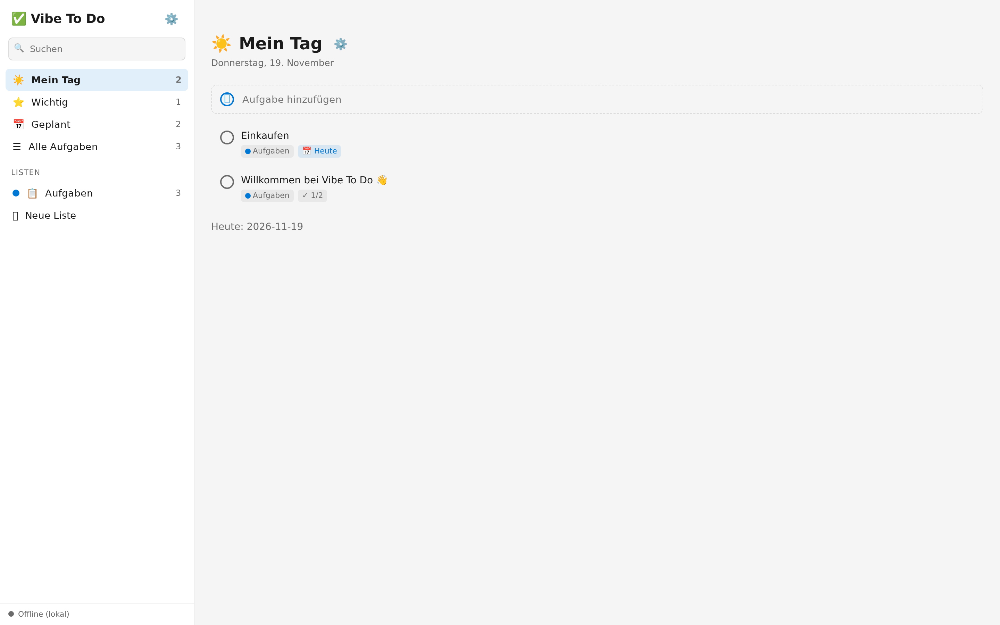
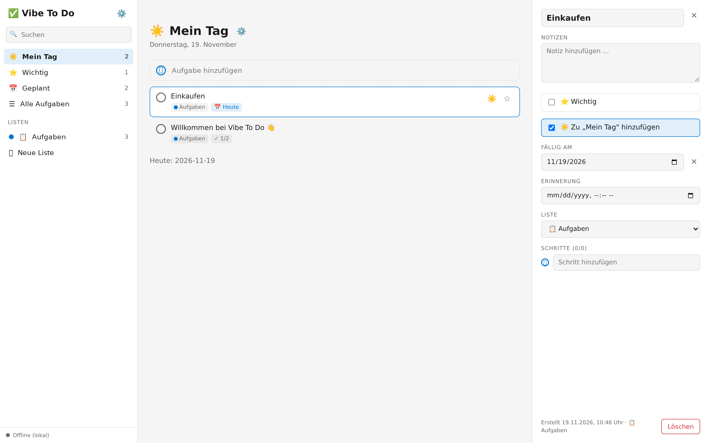
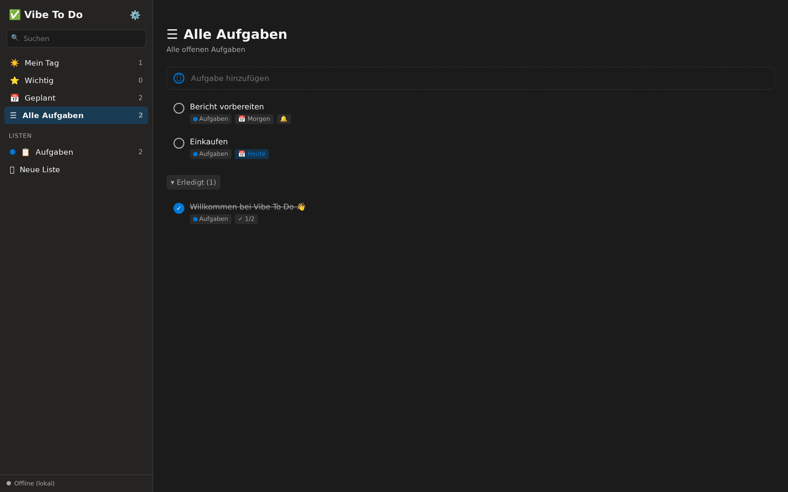
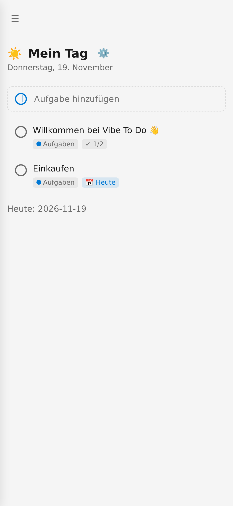

# ✅ Vibe To Do

Ein Aufgaben-Manager im Stil von **Microsoft To Do** – **aus einer einzigen Codebase** für:

| Plattform | Technologie | Befehl |
|---|---|---|
| 🌐 **Browser** (inkl. installierbarer PWA) | Vite + React + PWA | `npm run dev` / `npm run build` |
| 🪟 **Windows Desktop** | Electron-Wrapper | `npm run electron:dist` → `.exe`-Installer |
| 🤖 **Android** | Capacitor (WebView) | `npm run cap:android` |
| 🍎 **iOS** | Capacitor (WebView) | `npm run cap:ios` (nur macOS/Xcode) |

Alle vier Apps teilen sich **denselben Code, dieselbe UI und denselben lokalen Speicher** (IndexedDB –
funktioniert im Browser, in Electron und in den Capacitor-WebViews identisch). Über den eingebauten
**Sync-Server** halte ich den Stand auf allen Geräten synchron.

## Features

- 📋 **Eigene Listen** mit Farbe + Icon, Default-Liste „Aufgaben"
- ☀️ **Mein Tag**, ⭐ **Wichtig**, 📅 **Geplant**, ☰ **Alle Aufgaben** (Smart Lists)
- ✅ Aufgaben: abhaken, löschen, verschieben (Liste), Notizen
- 📅 Fälligkeitsdatum (Heute/Morgen/Überfällig-Badges) + 🔔 Erinnerung (Browser-Benachrichtigung)
- ➕ **Schritte** (Subtasks) pro Aufgabe
- 🔍 Suche über alle Aufgaben
- 🌗 Hell/Dunkel/System-Theme
- 🔄 **Sync zwischen Geräten** (Last-Write-Wins pro Aufgabe/Liste, Tombstones für Löschungen)
- 📱 PWA: im Browser installierbar (App-Icon, offline-fähig via Service Worker)

## Screenshots

Echte Screenshots der laufenden App (Headless Chromium, siehe `tools/screenshot.mjs`):

| Desktop – Mein Tag (hell) | Desktop – Aufgaben-Detail |
|---|---|
|  |  |

| Desktop – Alle Aufgaben (dunkel, mit Erledigt) | Mobile – Mein Tag (390 px) |
|---|---|
|  |  |

Neu erzeugen: `npm run build && npx vite preview --port 4818 &` dann `npm run screenshots`
(env `BASE_URL` überschreibt die Ziel-URL).

## Schnellstart

```bash
npm install
npm run dev        # Web-Entwicklung: http://localhost:5173
npm test           # 21 Tests (Merge-Logik, Store, Sync-Server)
npm run typecheck  # TypeScript
npm run build      # Produktion nach dist/
```

### 🌐 Browser / PWA

```bash
npm run build
npx vite preview          # lokal testen: http://localhost:4173
# oder dist/ auf einen beliebigen statischen Hoster legen (Netlify, GitHub Pages, nginx, …)
```

Im Browser (Chrome/Edge) über das Menü **„Als App installieren“** → läuft wie eine Desktop-App.

### 🪟 Windows Desktop (Electron)

```bash
npm run electron:dev      # Dev: baut dist/ und startet Electron
npm run electron:dist     # Release: release/Vibe-To-Do-Setup-x64.exe (NSIS-Installer)
```

> Hinweis: Beim ersten `npm install` lädt Electron das Binary herunter (hier im Sandbox per
> `ELECTRON_SKIP_BINARY_DOWNLOAD=1` übersprungen). `electron-builder` lädt NSIS beim ersten
> `electron:dist` nach.

### 🤖 Android (Capacitor)

Voraussetzung: Java 17+, Android Studio mit SDK.

```bash
npm run cap:add:android   # einmalig: erzeugt android/
npm run cap:android       # baut dist/, synchronisiert, öffnet Android Studio
```

In Android Studio dann **Run** (Emulator/Gerät) oder **Build → Generate Signed Bundle / APK** für den Play Store.

### 🍎 iOS (Capacitor)

**Nur auf einem Mac mit Xcode möglich** (Apple erlaubt iOS-Builds ausschließlich unter macOS –
das ist eine Apple-Einschränkung, kein Projekt-Problem):

```bash
npm run cap:add:ios       # einmalig: erzeugt ios/
npm run cap:ios           # baut dist/, synchronisiert, öffnet Xcode
```

In Xcode: Team/Scheme wählen → Run auf Simulator oder Gerät; für den App Store: **Product → Archive**.

### 🔄 Sync-Server (damit alle Geräte denselben Stand haben)

```bash
npm run sync-server       # läuft auf http://127.0.0.1:4173, Daten in server/data.json
# für Zugriff aus dem eigenen LAN (nur trusted network!):
HOST=0.0.0.0 PORT=4173 npm run sync-server
```

In der App unter **⚙️ Einstellungen → Sync-Server** die URL eintragen (z. B. `http://192.168.1.10:4173`),
„Speichern“ – danach synchronisiert die App automatisch (alle 60 s + nach jeder Änderung, debounce 1,5 s).

**API** (keine externen Abhängigkeiten, plain Node):

- `GET /health`
- `GET /api/state?since=<ISO>` → Änderungen seit Zeitstempel
- `POST /api/state` `{ lists, tasks }` → LWW-Merge

## Architektur

```
┌──────────────────────── 一 Codebase ─────────────────────────┐
│  src/            React-UI (Sidebar, Aufgaben, Detail, Settings) │
│  src/store/      State + IndexedDB-Persistenz (idb)            │
│  src/sync/       Sync-Client (Push/Pull, inkrementell)         │
│  shared/merge.mjs  LWW-Merge – wird von Client UND Server genutzt│
│  public/         PWA (Manifest, Service Worker, Icons)         │
└──────────┬───────────────┬──────────────┬─────────────────────┘
           ▼               ▼              ▼
      Browser/PWA     Electron       Capacitor
      (dist/)      (Windows .exe)   (Android/iOS WebView)
                        ▲
              server/sync-server.js  (optional, JSON-Datei, Loopback-Default)
```

- **Persistenz:** IndexedDB (`vibe-todo`) – identisch auf allen vier Plattformen, da Electron und
  Capacitor die Web-App in einer Chromium-WebView ausführen.
- **Sync:** pro Entität (Liste/Aufgabe) Last-Write-Wins anhand `updatedAt` (Tombstone `deletedAt`),
  deterministischer Tiebreak über die ID. Inkrementell via `since`.
- **iOS-Build:** im Linux-Sandbox nicht kompilierbar (braucht macOS + Xcode) – Code und
  Capacitor-Konfiguration sind fertig, auf dem Mac nur `npm run cap:ios` ausführen.

## Projektstruktur

```
├── index.html / vite.config.ts / tsconfig.json / capacitor.config.ts
├── electron/            Electron-Main (Windows/macOS/Linux-Fenster)
├── electron-builder.yml NSIS-Installer-Konfiguration (Windows)
├── public/              PWA: manifest.webmanifest, sw.js, favicon.svg, icon-*.png
├── server/              sync-server.js (dependency-frei, JSON-Datei)
├── shared/merge.mjs     Sync-Merge (Client + Server)
├── src/
│   ├── model/types.ts   Datenmodell
│   ├── store/           db.ts (IndexedDB), store.ts (State/Aktionen)
│   ├── sync/sync.ts     Sync-Client
│   ├── components/      Sidebar, TaskView, TaskDetail, Settings
│   └── util/format.ts   Datumsformatierung (de-DE)
├── tests/               vitest: merge, store (fake-indexeddb), sync-server (Loopback)
└── tools/make-icons.py  App-Icons ohne externe Abhängigkeiten neu generieren
```

## Ausblick / nicht enthalten

- Kein Microsoft-Konto/Graph-API-Sync (braucht OAuth-Registrierung bei Microsoft) – stattdessen
  der mitgelieferte Sync-Server.
- Native Push-Benachrichtigungen auf iOS/Android würden `@capacitor/local-notifications` benötigen;
  im Web/Browser funktionieren Erinnerungen bereits über die Notification-API.
